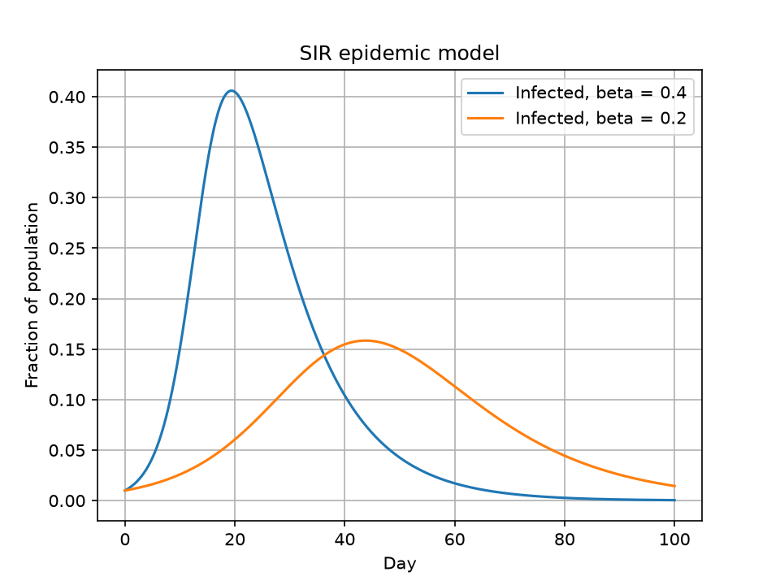
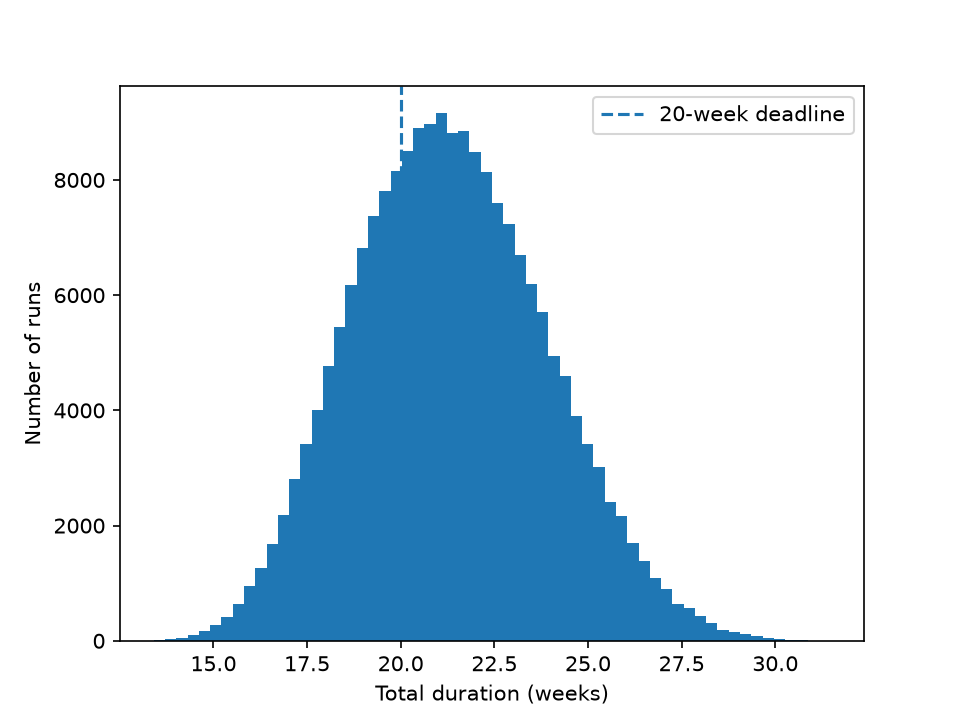

# BIT 2118 Scientific Computing – Group Work

**Student:** Yvonne Moseti\
**Department:** Computing and Informatics\
**Unit:** Scientific Computing (BIT 2118)\
**Academic Year and Semester:** 2026, September–December


## 1. Repository overview

This repository holds the solutions to Tasks 2–20 of the Scientific Computing group assignment. All of the work is written in Python and makes use of NumPy, SciPy and Matplotlib. Each task was approached in four steps:

1. Determining the **input values** and the **mathematical operation** carried out by the program.
2. **Altering at least one input or parameter** and describing the effect on the result.
3. Describing **what the output means** in plain language, together with an interpretation of any graph produced.
4. **Adapting the program to a different but related real-world problem**, and recording its assumptions, input data, output and interpretation.

## 2. Tools and libraries

| Library | Role in this project |
|---|---|
| NumPy | Arrays, vectorized operations, matrix operations, linear algebra and random number generation |
| SciPy | LU decomposition, root finding, systems of nonlinear equations, interpolation, curve fitting, integration, ODE solvers and optimization |
| Matplotlib | Plots of convergence, fitted curves, interpolated data, ODE solutions and simulations |
| timeit | Timing a plain Python loop against equivalent vectorized NumPy code |

Python 3.10 or later is recommended. **NumPy 2.0 or later is mandatory**, since Task 16 relies on `np.trapezoid`.

## 3. Repository layout

```text
.
├── README.md
├── requirements.txt
├── .gitignore
├── code/          Original and modified programs for Tasks 2–20
├── code_outputs/  Console output of each program run
├── images/        Saved graphs (PNG)
└── docs/          Written report (PDF and Word)
```

The written report, [BIT_2118_Scientific_Computing Group Work.pdf](docs/BIT_2118_Scientific_Computing%20Group%20Work.pdf) (with an editable Word copy, [Scientific Computing Group work.docx](docs/Scientific%20Computing%20Group%20work.docx)), explains every task in full: the inputs and operation, the parameter change, the meaning of the output, the adapted scenario, and the interpretation of each graph.

For every task, the `code/` folder contains two programs: the original version (for instance `Task_02_numpy_arrays.py`) and a modified version that addresses a related real-world scenario (for instance `Task_02_numpy_arrays_modified.py`).

## 4. Running the programs

```bash
# 1. Create and activate a virtual environment
python -m venv .venv
.venv\Scripts\activate            # Mac/Linux: source .venv/bin/activate

# 2. Install the required libraries
pip install -r requirements.txt

# 3. Run a program (always from the repository root)
python code/Task_02_numpy_arrays.py
python code/Task_02_numpy_arrays_modified.py
```

To write a program's console output to a file:

```bash
python code/Task_02_numpy_arrays.py > code_outputs/Task_02_output.txt
```

Any program that produces a graph will open a Matplotlib window; the program finishes once that window is closed. The graph is also saved as a PNG in `images/`, and the folder is created automatically if it is missing.

## 5. Tasks and their real-world adaptations

| Task | Topic | Original problem | Adapted scenario | Modified program |
|---|---|---|---|---|
| 2 | NumPy arrays | Temperature readings from a weather station | Greenhouse sensor located in the Nairobi highlands | `Task_02_numpy_arrays_modified.py` |
| 3 | Vectorization | Converting network latency values | Converting internet bandwidth from Mbps to MB/s | `Task_03_vectorization_modified.py` |
| 4 | Floating-point errors | 0.1 + 0.2 and a numerically unstable formula | Rounding error building up in banking calculations | `Task_04_numerical_errors_modified.py` |
| 5 | Matrix algebra | Rotation and scaling of a square | Waypoints of a robot arm | `Task_05_matrix_algebra_modified.py` |
| 6 | Linear systems | Determining the number of active servers | Currents in a two-loop circuit | `Task_06_linear_systems_modified.py` |
| 7 | Gaussian elimination and LU | A single matrix with several sets of measurements | A four-node structure carrying a load | `Task_07_gaussian_lu_modified.py` |
| 8 | Iterative methods | Temperature on a five-point grid | A metal rod modelled with seven points | `Task_08_iterative_linear_modified.py` |
| 9 | Eigenvalues | Ranking node importance in a 4-node network | A network of five friends | `Task_09_eigenvalues_modified.py` |
| 10 | Bisection and fixed point | Finding an equilibrium temperature | Finding the break-even production level | `Task_10_root_finding_modified.py` |
| 11 | Newton and secant | IRR of a series of cash flows | IRR of a 50,000 project or loan | `Task_11_irr_modified.py` |
| 12 | Nonlinear equations | Intersection of a circle and a parabola | Overlap between cell-tower coverage areas | `Task_12_nonlinear_modified.py` |
| 13 | Interpolation | Estimating 10-minute values from hourly temperatures | Cumulative rainfall | `Task_13_interpolation_modified.py` |
| 14 | Curve fitting | Server response time against number of users | Battery drain of a phone | `Task_14_curve_fitting_modified.py` |
| 15 | Numerical differentiation | Estimating speed from GPS positions | Estimating acceleration from velocity | `Task_15_differentiation_modified.py` |
| 16 | Numerical integration | Energy computed from smart-meter power readings | Distance computed from bus speed | `Task_16_integration_modified.py` |
| 17 | Euler method | Newton's law of cooling | Concentration of a drug in the bloodstream | `Task_17_euler_modified.py` |
| 18 | ODEs with SciPy | Charging of an RC circuit | The SIR epidemic model | `Task_18_scipy_ode_modified.py` |
| 19 | Optimization | Lowest-cost combination of servers | Lowest-cost combination of fertilizers | `Task_19_optimization_modified.py` |
| 20 | Monte Carlo | Probability of server overload | Risk of missing a project deadline | `Task_20_monte_carlo_modified.py` |

## 6. Summary of results

| Task | Main result of the original program | Result of the adapted scenario |
|---|---|---|
| 2 | Mean 23.12 °C, min 17.50 °C, max 29.40 °C | 7 hours above 25 °C, hottest hour 12 |
| 3 | Vectorized code runs far faster than a loop (roughly 40–57× on our machines; this varies between computers) | RMS speed 7.64 MB/s |
| 4 | `0.1 + 0.2 == 0.3` evaluates to False; the unstable formula loses accuracy at x = 1e-12 | float32 sum of 0.01 × 100,000 gives about 1000.665 |
| 5 | Determinant 3, equal to the area scale factor 2 × 1.5 | Rectangle rotated 30° and shifted by (3, 2) |
| 6 | 3 Type A and 4 Type B servers | I1 = 0.4364 A, I2 = 0.0545 A |
| 7 | x = [5, 5, 5] for the first set of measurements | Load [10,0,0,5] gives [3.909, 1.727, 1.273, 2.091] |
| 8 | T = [86.67, 73.33, 60, 46.67, 33.33]; Jacobi needs 150 iterations and Gauss-Seidel 75 | Rod: Jacobi needs 263 iterations and Gauss-Seidel 132 |
| 9 | Dominant eigenvalue 2.5616; B and C are the most important nodes | λ = 2.2143; person C is the most central |
| 10 | Equilibrium at 27.525211 °C (38 steps with bisection, 13 with fixed point) | Break-even reached at 68.218 units |
| 11 | IRR of 11.542461% | IRR of 15.2382% |
| 12 | Two real intersection points at (±1.5175, 1.3028) | The towers' coverage edges meet at (3.75, ±3.3072) |
| 13 | At 10:30: 23.25 °C (linear), 23.36 °C (cubic) | At hour 10: 9.50 mm (linear), 9.71 mm (cubic) |
| 14 | Quadratic fit with RMSE 1.55 ms; 377.86 ms predicted at 400 users | Battery half-life of 7.57 h; 20% remaining at about 17.6 h |
| 15 | Speed increases from 4.80 to 8.00 m/s | Acceleration decreases from 3.20 to 2.10 m/s² |
| 16 | 15.700 kWh (trapezoid), 15.800 kWh (Simpson) | Distance of 310.0 m (trapezoid), 316.7 m (Simpson) |
| 17 | Euler gives 26.40 °C against the exact 26.78 °C (error 0.372) | A step of h = 12 h is unstable (11.5778 instead of 0.1573) |
| 18 | Capacitor reaches 4.9663 V after 5 s, with an error of about 9.3e-10 V | β = 0.4 peaks at 40.6% on day 19.4; β = 0.2 peaks at 15.8% on day 43.8 |
| 19 | Optimal mix is 5.882 Type B (cost 105.88); with whole servers, 6 Type B (cost 108) | 1 bag of F1 + 0.4 bag of F2 (cost 46); with whole bags the cost is 60 |
| 20 | Probability of overload is 10.616% | 68.1% chance of going beyond 20 weeks; 90th percentile at 24.7 weeks |

## 7. Sample graphs

**Task 18 (modified): SIR epidemic model.** A higher infection rate (β = 0.4) produces an earlier and much taller peak than β = 0.2.



**Task 20 (modified): Monte Carlo project-deadline risk.** Most simulated project durations fall after the 20-week deadline, giving a 68.1% chance of missing it.



The remaining graphs are in the `images/` folder.

## 8. Assumptions and notes

- The data used in the modified programs is assumed or made up for the purposes of the exercise; it does not come from real measurements.
- Random simulations use fixed seeds so that the results can be reproduced. Using a different seed will give slightly different values.

## 9. References

- NumPy documentation: https://numpy.org/doc/
- SciPy documentation: https://docs.scipy.org/doc/scipy/
- Matplotlib documentation: https://matplotlib.org/stable/
- BIT 2118 Scientific Computing Group Work handout

## 10. Academic integrity

Although the tasks were discussed as a group, this repository is my own individual submission, in line with the unit's instructions.
